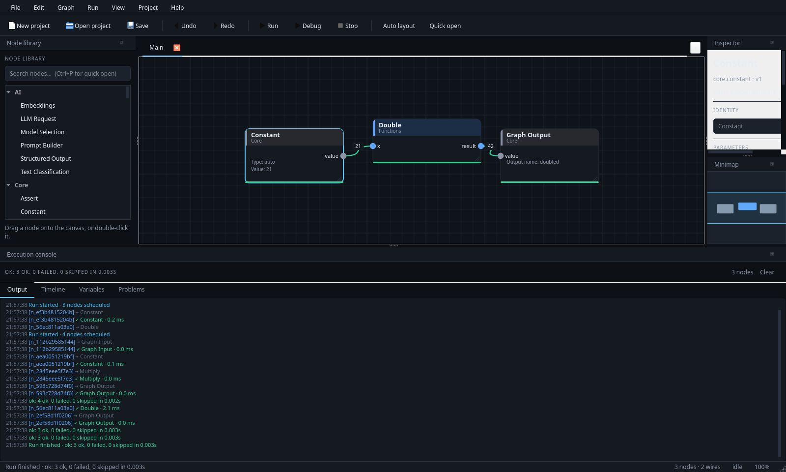

# SYNAPSE

**SYNAPSE** is a desktop visual programming environment where the graph *is* the program. Connect typed nodes into dataflow graphs, run and debug them inside the app, turn part of a graph into a reusable function, drop in Python where the built-in nodes stop, and export the result.

It is not a mockup: a graph is validated, ordered and executed by an asynchronous engine that also powers the visual debugger and the exported Python program.



## Highlights

- **Graph-native execution** — dependency-resolved dataflow, parallel branches, async I/O, cancellation, timeouts, step and loop limits, per-node caching and per-node timing. Nothing runs on the UI thread.
- **Typed ports** — boolean, integer, float, string, bytes, array, dictionary, image, audio, video, file, object, any; plus optional values, custom types, compatibility checks and explicit conversion nodes.
- **108 built-in nodes** across Logic, Mathematics, Data, Files, Networking, AI, Graphics, System, Scripting and Core, and every one executes real work.
- **Visual debugging** — breakpoints, step, pause/resume, stop, live node inputs/outputs, variables, wire values, trace history and timing.
- **Functions** — select nodes, extract them into a reusable function with typed parameters and return values, call it from any graph (functions may call other functions).
- **Python scripting** — script nodes with an in-app editor, executed in a separate `python -I` interpreter with a timeout and import allow-list.
- **Projects** — versioned `.synapse` JSON projects, multiple graphs, functions, assets, settings, templates, autosave and crash recovery, recent files in SQLite.
- **Extensions** — discoverable node packages with manifests, install/remove/enable, compatibility checks and failure isolation. Two example plugins ship with the app.
- **Code generation** — one shared IR feeds the executor, JSON export and standalone Python export. Unsupported constructs are reported, never silently mistranslated.
- **IDE-grade canvas** — infinite pan/zoom canvas, curved wires, multi-select, resize, grouping frames, minimap, searchable library, context menus, full undo/redo, copy/paste, auto-layout and keyboard shortcuts.

## Install and run

Requires Python 3.11+ and a desktop session (Qt).

```bash
python -m venv .venv
source .venv/bin/activate          # Windows: .venv\Scripts\activate
pip install -e .

synapse                            # or: python -m synapse
synapse path/to/project.synapse    # open a project directly
```

On a headless machine, Qt still needs a display; use `xvfb-run -a synapse`.

## First five minutes

1. Choose a template on the welcome screen (try **Arithmetic** or **Loop**).
2. Double-click the canvas, or use the left library, to add nodes.
3. Drag from an output port to an input port. Incompatible types are refused with an explanation.
4. Press **Ctrl+Enter** to run. Results appear in the console and execution is traced on the canvas.
5. Press **F5** to debug: right-click a node (or use the inspector) to toggle a breakpoint, then step, inspect values and resume. **Shift+F5** stops a run.

Common shortcuts: `Ctrl+N` new project, `Ctrl+S` save, `Ctrl+O` open, `F5` run, `Shift+F5` debug, `Ctrl+K` find, `Ctrl+Z`/`Ctrl+Shift+Z` undo/redo, `Ctrl+K` quick open, `F1` shortcut list.

## Examples

`examples/` contains ready-to-open projects and an exported program:

| File | What it shows |
| --- | --- |
| `examples/arithmetic.synapse` | Constants, arithmetic and a graph output |
| `examples/loops.synapse` | A loop body calling a reusable function |
| `examples/functions.synapse` | Function extraction and function calls |
| `examples/python-script.synapse` | A Python script node transforming graph data |
| `examples/json-data.synapse` | JSON parsing and dictionary access |
| `examples/blank.synapse` | Empty project for starting from scratch |
| `examples/exported_arithmetic.py` | Standalone Python export of a graph |

Run an exported graph without the UI:

```bash
python examples/exported_arithmetic.py --pretty
```

## Tests

```bash
pip install -e ".[dev]"
pytest
```

The suite covers the type system, graph model and serialisation, executor semantics (ordering, parallel branches, cancellation, limits, caching, error isolation), every built-in node, loops, functions and nested calls, debugger sessions, the compiler and generated program, project save/load/recovery, plugins, and offscreen smoke tests of the desktop shell and canvas.

## Repository map

```
synapse/
  typesystem/    types, ports, conversion, custom types
  graph/         Qt-free graph model, validation, serialisation
  nodes/         node definition/registry and the built-in library
  engine/        async dataflow executor, context, security policy, events
  debugger/      tracing session and value formatting
  functions/     reusable sub-graphs and structural extraction
  compiler/      shared IR, Python and JSON generation
  project/       project format, templates, store, SQLite database
  scripting/     isolated Python interpreter integration
  extensions/    plugin manifest, API, manager, bundled plugins
  application/   PySide6 desktop UI (canvas, panels, dialogs, themes)
tests/           pytest suite
examples/        sample projects and exported code
documentation/   architecture, project format, node catalogue, security, plugins
scripts/         maintenance utilities
```

## Documentation

- [Architecture](documentation/ARCHITECTURE.md) — engine, IR, threading model, extension points.
- [Project format](documentation/PROJECT_FORMAT.md) — versioned schema for `.synapse` files.
- [Node catalogue](documentation/NODE_LIBRARY.md) — every node and its ports.
- [Security model](documentation/SECURITY.md) — trust boundaries for scripts, plugins and I/O.
- [Plugins](documentation/PLUGINS.md) — writing and packaging node extensions.

## Status and limitations

Version 1.0 is a working desktop environment, not a complete replacement for a general-purpose IDE.

- Network, file, process and AI nodes are real implementations, but AI nodes call OpenAI-compatible HTTP endpoints and need a key provided through an environment variable.
- Python export runs the compiled graph through the embedded SYNAPSE runtime; it does not emit idiomatic Python for every construct, and nodes without a native lowering are listed in the generated file. JavaScript export is not implemented. We do not claim perfect translation of arbitrary graphs to any language.
- The script sandbox is process isolation with an import allow-list and timeout, not an OS-level security boundary. Python plugins load in-process, so install only code you trust. See the security model.
- Visual languages for Audio/Video exist as typed ports and media wrappers; the built-in node set focuses on images for graphics processing.
- Linux/Windows/macOS are supported through Qt; CI-tested only on Linux at release time.

## License

MIT — see [LICENSE](LICENSE).
